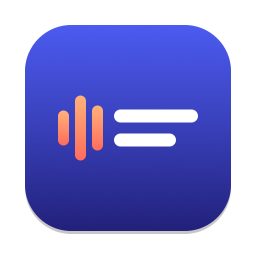

<p align="center">
  
</p>

<h1 align="center">Roomline</h1>

<p align="center">
  영어 미팅에 실시간 자막과 한국어 번역을 띄우고, 미팅이 끝나면 노트까지 만들어 주는 macOS 메뉴 막대 앱.<br>
  음성 인식과 번역은 모두 맥 안에서 처리합니다.
</p>

---

## 무엇을 하나요

미팅 중에는 화면 아래에 자막 패널이 떠 있습니다. 상대가 말하면 영어 자막이 먼저 나오고, 문장이 확정되면 바로 아래에 한국어 번역이 붙습니다.

```
상대  Can we ship the ground segment update by next Friday?
      다음 주 금요일까지 지상국 업데이트를 배포할 수 있을까요?
나    Yes, I'll send the test report by Wednesday.
```

미팅을 종료하면 다음 작업이 백그라운드에서 이어집니다.

1. 상대 음성을 화자별로 구분합니다 (상대 1, 상대 2 …).
2. 전사 내용을 요약해 `notes.md`를 만듭니다. 노트에는 요약, 결정사항, 액션아이템, 미해결 논의가 들어갑니다.

노트를 만드는 동안에도 새 미팅을 바로 시작할 수 있습니다.

## 주요 기능

**실시간 자막**
- 시스템 오디오는 "상대", 마이크는 "나"로 나눠서 받아 적습니다. 그래서 Zoom, Meet, Teams 등 어떤 미팅 앱에서도 동작합니다.
- 영어 미팅은 한국어 번역을 함께 보여 줍니다. 한국어 미팅은 번역 없이 자막만 띄웁니다.
- 상대의 영어 억양을 고를 수 있습니다 (미국, 인도, 영국, 호주, 싱가포르, 캐나다).

**자막 패널**
- 화면 공유와 녹화에는 패널이 잡히지 않습니다. 즉, 상대에게는 자막이 보이지 않습니다.
- "클릭 통과"를 켜면 패널 아래에 있는 창을 그대로 클릭할 수 있습니다.
- 글자 크기와 배경 불투명도를 조절할 수 있고, 끌어서 옮기거나 크기를 바꿀 수 있습니다.

**에코 제거**
- 스피커로 들으면 상대 목소리가 마이크로 다시 들어가 "나"의 발화로 중복됩니다. 그래서 상대 소리가 나는 동안에는 마이크 입력을 무음으로 바꿉니다.
- 출력 장치가 스피커일 때만 자동으로 켜집니다. 미팅 중에 에어팟을 연결하거나 빼도 그 변화를 따라갑니다.
- 그래도 남은 중복은 텍스트를 비교해서 한 번 더 걸러 냅니다.

**미팅 노트**
- 엔진은 두 가지 중에서 고릅니다. Ollama(로컬, 기본값 `gemma3:12b`) 또는 Claude(Claude Code CLI에 로그인된 구독).
- 1시간이 넘는 미팅은 1시간 구간별로 먼저 요약한 뒤 하나로 합칩니다.
- 화자에 이름을 붙이면 목소리 프로필이 저장됩니다. 그래서 다음 미팅부터는 같은 사람의 이름이 자동으로 채워집니다.

**기록과 복구**
- "미팅 기록" 창에서 지난 미팅의 노트와 전사를 보고, 이름을 바꾸거나 휴지통으로 옮길 수 있습니다.
- 전사는 문장이 확정될 때마다 파일에 덧붙여 씁니다. 그래서 녹음 중에 앱이 죽어도 그 시점까지의 내용이 남고, 메뉴에서 노트를 다시 만들 수 있습니다.

## 요구 사항

- macOS 26.4 이상, Apple Silicon 맥
- Xcode 26 (빌드용)
- 영어 → 한국어 번역 언어팩 (앱 설정에서 내려받을 수 있습니다)
- 노트 엔진 중 하나
  - [Ollama](https://ollama.com): `ollama pull gemma3:12b`
  - 또는 [Claude Code](https://claude.com/claude-code): `claude` 로그인

## 빌드와 실행

```sh
git clone https://github.com/Isaac-Lee/Roomline.git
cd Roomline
open Roomline.xcodeproj
```

Xcode에서 `Roomline` 스킴을 실행합니다. 의존성인 [FluidAudio](https://github.com/FluidInference/FluidAudio)는 Swift Package Manager가 자동으로 받습니다.

처음 실행하면 다음 두 가지 권한을 요청합니다.

| 권한 | 용도 |
| --- | --- |
| 마이크 | 내 발화를 자막으로 만듭니다 |
| 화면 및 시스템 오디오 녹화 | 상대 음성(시스템 오디오)을 받습니다. 화면 영상은 저장하지 않습니다 |

음성 인식 모델과 화자 구분 모델은 처음 쓸 때 한 번만 내려받습니다.

## 사용법

Roomline은 Dock 아이콘 없이 메뉴 막대에서만 동작합니다.

| 단축키 | 동작 |
| --- | --- |
| `⌃⌥S` | 미팅 시작 / 종료하고 노트 만들기 |
| `⌃⌥C` | 자막 패널 보이기 / 숨기기 |
| `⌃⌥X` | 클릭 통과 켜기 / 끄기 |

Siri와 단축어 앱에서도 쓸 수 있습니다. 앱 이름은 "룸라인"이라고 불러도 인식합니다.

- "Roomline으로 미팅 시작"
- "Roomline 미팅 종료"
- "Roomline 액션아이템" (마지막 미팅의 액션아이템을 읽어 줍니다)

## 데이터가 저장되는 곳

모든 기록은 `~/Library/Application Support/MeetingCaptions/` 아래에 있습니다.

```
MeetingCaptions/
├── voices.json                      # 이름을 붙인 화자의 목소리 프로필
└── meetings/
    └── 2026-11-10T1400_<UUID>/
        ├── meta.json                # 제목, 시작·종료 시각, 상태, 화자 이름
        ├── transcript.jsonl         # 전사, 번역, 화자 라벨 (append-only)
        ├── remote.m4a               # 상대 음성 (화자 구분용)
        ├── speakers.json            # 화자별 목소리 임베딩
        └── notes.md                 # 미팅 노트
```

## 개인정보

- 음성 인식(SpeechAnalyzer), 번역(Translation), 화자 구분(FluidAudio)은 모두 기기 안에서 실행됩니다.
- 노트 엔진이 Ollama이면 전사도 맥 밖으로 나가지 않습니다.
- 노트 엔진을 Claude로 바꾸면 전사가 Anthropic으로 전송됩니다.

## 구조

| 파일 | 역할 |
| --- | --- |
| `SessionController.swift` | 미팅 한 번의 생명주기와 노트 작업 큐 |
| `AudioCapture.swift` | ScreenCaptureKit 스트림 하나로 시스템 오디오와 마이크 수신, 에코 게이트 |
| `Transcription.swift` | SpeechAnalyzer 기반 음성 인식 (채널마다 하나) |
| `Translation.swift` | Apple 온디바이스 번역 (en → ko) |
| `EchoDedup.swift` | 텍스트 비교로 에코 판별 |
| `OverlayController.swift` | 자막 패널 |
| `Diarizer.swift`, `VoiceProfiles.swift` | 미팅 후 화자 구분과 목소리 프로필 |
| `NotesGenerator.swift` | Ollama / Claude로 미팅 노트 생성 |
| `TranscriptStore.swift` | 미팅 폴더 읽기와 쓰기 |
| `MeetingsView.swift`, `SettingsView.swift` | 미팅 기록 창과 설정 창 |
| `SiriIntents.swift`, `HotKeys.swift` | Siri·단축어 인텐트와 전역 단축키 |

## 테스트

```sh
Tests/selfcheck.sh                                  # 전사 저장, 노트 전처리, 에코 판별 검증
Tests/bench/bench.sh <오디오> <정답.txt> [로캘...]    # 로캘별 음성 인식 WER 측정
```
